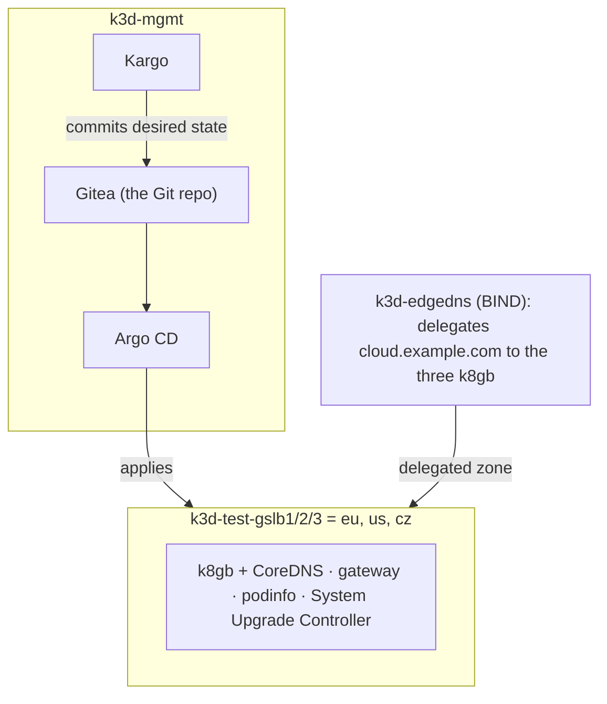

# Zero-traffic region upgrades with k8gb, Argo CD and Kargo

A demo you can run on a laptop (k3d, three regions) of one pattern:

> Before a region is changed, take it **out of global DNS rotation**. Change it and verify it while it
> receives **no user traffic**. Put it back. One region at a time, all of it declared in Git.

- **k8gb** steers global traffic (DNS-based GSLB).
- **Argo CD** applies the Git state to every regional cluster.
- **Kargo** orchestrates the rollout region by region and runs the verifications.

The change used as the example is a **Kubernetes upgrade** (k3s, `1.35 → 1.36 → 1.37`) done with
[System Upgrade Controller](https://github.com/rancher/system-upgrade-controller). It is a good case: it touches every
pod and the API of a region, and an app-level canary cannot cover it.

It is also a way to find out what k8gb needs for this to be a first-class pattern: see [Findings for k8gb](#findings-for-k8gb).

## What you see

`make watch` resolves the demo host through the edge DNS once per second, calls the first address it gets and counts errors:

```
14:41:17  dns=[us]        answer=us  k8s=eu:v1.35.9,us:v1.35.9,cz:v1.35.9  err=0 <- dns: [cz,eu,us] -> [us]
14:41:55  dns=[us]        answer=us  k8s=eu:v1.36.6,us:v1.35.9,cz:v1.35.9  err=0 <- k8s: eu:v1.35.9,... -> eu:v1.36.6,...
14:42:58  dns=[cz,eu,us]  answer=us  k8s=eu:v1.36.6,us:v1.35.9,cz:v1.35.9  err=0 <- dns: [us] -> [cz,eu,us]
```

`eu` leaves the DNS, its Kubernetes is upgraded while it receives nothing, then it comes back; `err` does not move.
Measured over a full run (`evidence/three-regions-run/`): 2784 requests, **4 failed, all of them in the control run** that upgrades
a region *without* draining it; **0 failed** in everything that went through the pipeline, including an upgrade that cannot
complete (the region stays drained, the others keep serving). One request per second against a tiny app proves the mechanism,
not production behavior: see [Limits](#limits).

## How it works



Kargo has **three independent branches, one per region**, of three stages each:

```
 Warehouse ─┬▶ eu-drain ─▶ eu-upgrade ─▶ eu-restore
            ├▶ us-drain ─▶ us-upgrade ─▶ us-restore
            └▶ cz-drain ─▶ cz-upgrade ─▶ cz-restore
```

| Stage | Promotion | Verification |
|---|---|---|
| `<r>-drain` | refuses a skipped Kubernetes minor or a downgrade; sets `gslb/rotation.yaml` to `failover` with the region's **receiver** as primary; Argo CD applies it to all regions | a Job: the edge DNS no longer returns the region (polls, so it **measures** the drain) |
| `<r>-upgrade` | sets the k3s version in the region's two `Plan`s; Argo CD applies them; then an `http` step asks the region's API server until **every node is at the new version, Ready and schedulable**, or fails after 6 min | a Job: the region's gateway answers, called directly (bypassing GSLB) |
| `<r>-restore` | `roundRobin` again | a Job: the edge DNS returns the region again |

You start a region by promoting its `<r>-drain` (CLI or Kargo UI drag and drop); the rest of the branch follows by itself.

Design points worth knowing:

- **The Freight list is a notification.** One Warehouse watches `rancher/k3s-upgrade` tags and creates a Freight for the newest version;
  `make freight-sync` adds the newest patch of each minor (Kubernetes goes one minor at a time). Nothing rolls out until you promote a Freight.
- **Drain = `failover`, not `weight: 0`.** With `weight: 0` k8gb still returns the region (last). With `failover` the **receiver**
  (eu→us, us→cz, cz→eu) serves everybody and the other region is out too: a real limit with three regions (see findings).
- **Safety interlock** in the shared drain task: `rotation.yaml` records which region is drained (annotation `region-upgrades-drained`);
  a second drain is refused, and the drain waits for the other regions' Applications to be healthy.
- **A failed upgrade fails loudly.** The node check is a step of the Promotion, not a Verification: Kargo only verifies a Stage that is
  healthy, and Argo CD's health can be stale right after a sync. The region stays drained.
- **Argo CD uses `automated` sync with `prune` + `selfHeal`**, because Kargo's `argocd-update` never prunes, and `argocd-update` is used without
  `desiredRevision`: with it, every later commit on the branch turns earlier stages `Unhealthy` (NOTES.md §3).
- Git is an in-cluster Gitea (no GitHub token needed). Podinfo is only the workload to protect.

## Run it

Needs Docker (Colima or Docker Desktop) with **14 GB RAM and 40+ GB free disk**, `k3d`, `kubectl`, `helm`, `yq` (mikefarah), `jq`, `dig`,
`htpasswd`, `openssl`. `make preflight` checks them and the free host ports.

```sh
make up                 # about 15-20 min: clusters, Argo CD, Kargo, Gitea, pipelines; ends when everything answers
make watch              # in a second terminal, leave it running
make freight            # the k3s versions you can roll out (start: v1.35.9)

make demo-kubernetes VERSION=v1.36.6-k3s1                           # upgrade eu, us, cz in turn
make demo-kubernetes-nodrain REGION=cz VERSION=v1.37.2-k3s1         # control: same upgrade WITHOUT drain
make demo-kubernetes-bad                                            # an upgrade that cannot complete
make ui-kargo           # https://localhost:8082      make ui-argocd   # http://localhost:8081
make down               # removes everything this repo created
```

[DEMO.md](DEMO.md) is the step-by-step walkthrough, with what to look at and what every script does.

## Findings for k8gb

What running this showed, with the measurements in [NOTES.md](NOTES.md). Candidates for upstream contributions:

1. **`weight: 0` does not take a region out of DNS.** The CoreDNS plugin returns every record and only orders them (zero weights last); through a
   parent DNS that reorders, the region is still first a third of the time. The weighting library already has a "drop zero weights" mode that the
   plugin hard-codes off. A small patch with tests makes it a Corefile option (`loadbalance weight dropzero`, default unchanged):
   [`tools/coredns-dropzero/`](tools/coredns-dropzero/), tried live in the demo (NOTES.md §1, §6).
2. **`failover` with three regions** returns only the primary: draining one region also takes the third one out. It splits the drained
   region's traffic over the others only when the drained region is the primary *and unhealthy*, which cannot be verified while drained.
   `weight: 0` + `dropzero` divides it by weight for any number of regions (`scripts/k8gb-three-regions.sh` measures all modes; NOTES.md §10).
3. **The drain does not cover the nameserver role.** A k8gb that answers NXDOMAIN made the edge return NXDOMAIN for every query even with its
   region out of rotation; there is no declarative way to drop a cluster's nameserver from the delegation (NOTES.md §5).
4. **The operator stopped reconciling a `Gslb` twice** (only the `ZoneDelegation` loop kept logging) until restarted; cause not found (NOTES.md §6).
5. **Local setup**: k8gb's k3d configs pin the k3s image, so a demo cannot start at an older Kubernetes without copying them; the setup installs
   Istio and the retired ingress-nginx unconditionally.

Nothing has been filed upstream.

## Limits

- A DNS drain is not instant: TTLs and resolver caches (some ignore TTLs) decide it. The demo uses a 5 s TTL; production TTLs are longer.
- DNS only moves **new** connections: long-lived ones (HTTP/2, gRPC, WebSocket) stay on the drained region. Not tested.
- The receiver must absorb all the traffic (and, with `failover`, the third region is out as well).
- Verification uses synthetic traffic, not real users or SLOs. One client, one request per second, no real load.
- k3d hides what a real upgrade has: HA control plane and etcd, add-on and API compatibility, real network distances. The `Plan`s carry a k3d-only workaround.
- Three regions at most were tried. Docker may change container IPs when nodes restart; `scripts/refresh-addresses.sh` repairs what that breaks.
- Demo-grade security: Git credentials over HTTP, admin accounts, a long-lived read-only token for the node check.

## Layout

```
gitops/      what Argo CD syncs: gslb/rotation.yaml (the single source of truth for the rotation), per-region Plans, podinfo, ApplicationSets
kargo/       the shared drain/restore task (with the interlock), verification templates, the project: one Warehouse and nine stages
scripts/     make's helpers; DEMO.md explains each
bootstrap/   pinned versions and Helm values for Argo CD, Kargo, Gitea
tools/       the probe image and the CoreDNS patch (`dropzero`) used by the k8gb experiments
evidence/    raw output of the runs behind the numbers
k8gb/        k8gb's own repo at a pinned commit (cloned by make, gitignored, never modified)
```
